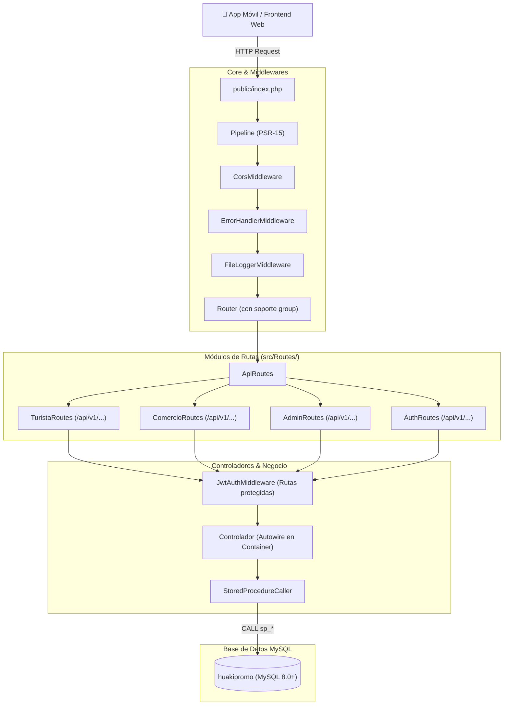

# Arquitectura y Diseño del Sistema

## 1. Principios de Diseño

1. **Cero Dependencias en Producción (Zero Framework Overhead):**
   * El servicio arranca en **5 a 15 ms** con un consumo de memoria inferior a **20 MB**, garantizando máxima respuesta en servidores provinciales sin requerir infraestructuras complejas.
2. **Modelos Inmutables (PSR-7 Inspired):**
   * Las clases `Request` y `Response` en `src/Core/Http/` encapsulan de forma inmutable el estado HTTP.
3. **Pipeline Onion de Middlewares (PSR-15):**
   * Cada petición atraviesa una cebolla de middlewares:
     $$\text{Request} \longrightarrow \text{CORS} \longrightarrow \text{ErrorHandler} \longrightarrow \text{FileLogger} \longrightarrow \text{Router/Auth} \longrightarrow \text{Controller}$$
4. **Desacople de Persistencia:**
   * La API no construye sentencias SQL `SELECT`, `INSERT` ni `UPDATE` directas; interactúa exclusivamente con la capa de procedimientos almacenados `huakipromo` a través de `StoredProcedureCaller`.

---

## 2. Diagrama de Ciclo de Vida de la Petición



---

## 3. Contrato de Respuesta Canónico (BFF Envelope)

Todas las respuestas de la API devuelven una estructura JSON estándar predecible para el cliente:

### Éxito (Códigos `200 OK`, `201 Created`):
```json
{
  "ok": true,
  "data": { ... },
  "meta": {
    "total": 10,
    "pagina": 1
  }
}
```

### Error Canónico (Códigos `400`, `401`, `403`, `404`, `409`, `500`):
```json
{
  "ok": false,
  "error": {
    "codigo": "RECURSO_NO_ENCONTRADO",
    "mensaje": "La promoción solicitada no existe o ya venció.",
    "detalles": null
  }
}
```

---

## 4. Contenedor de Inyección de Dependencias (DI Container)

Ubicado en `src/Core/Container/Container.php`:
* Resuelve dependencias automáticamente mediante **PHP Reflection**.
* Si un controlador declara en su constructor `StoredProcedureCaller $sp` o `JwtService $jwt`, el contenedor inspecciona sus tipos y los instancia sin necesidad de configuración manual.
* Permite registrar *singletons* o instancias personalizadas cuando se requiera mockear componentes en pruebas.

---

## 5. Enrutador Modular con Grupos y Prefijos

Ubicado en `src/Core/Router/Router.php`:
* **Grupos y prefijos jerárquicos:**
  ```php
  $router->group('/api/v1', function (Router $api) {
      $api->group('/turista', function (Router $turista) {
          $turista->get('/cupones', [CuponesController::class, 'misCupones']);
      }, [JwtAuthMiddleware::class]);
  });
  ```
* **Extracción de Parámetros de Ruta:** Parsea comodines dinámicos como `:id` o `:codigo` y los inyecta en el método del controlador:
  ```php
  public function show(Request $request, array $params = []): Response
  {
      $codigo = $params['codigo'];
      ...
  }
  ```
