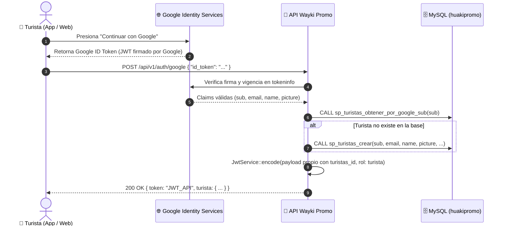

# Autenticación y Seguridad JWT

La API Wayki Promo implementa un modelo de **Autenticación Dual** adaptado a los dos tipos de usuarios que interactúan con la plataforma:
1. **Turistas Móviles:** Acceso inmediato y sin fricción mediante **Google OAuth 2.0 (Federado)**.
2. **Operadores de Comercios y Funcionarios del Ente:** Acceso corporativo mediante **credenciales locales (Email + Password Hash)**.

Ambos flujos convergen en la emisión de un **Bearer Token JWT propio** de la API, firmado con `HS256`.

---

## 1. Diagrama de Secuencia de Autenticación con Google



---

## 2. Emisión de Token JWT de la API

Una vez validada la identidad (sea por Google o por contraseña), el servicio [src/Services/JwtService.php](file:///Users/jferreyradev/projects/turismo/api-waykipromo/src/Services/JwtService.php) firma un token con algoritmo `HS256` utilizando la clave `JWT_SECRET` (definida en el `.env`, mínimo 32 caracteres).

### Estructura del Payload:
```json
{
  "sub": "tur_142",
  "turistas_id": 142,
  "email": "turista@gmail.com",
  "nombre": "Ana Gómez",
  "rol": "turista",
  "comercio_id": null,
  "iat": 1731931200,
  "exp": 1734523200
}
```

* **Vigencia móvil:** 30 días para turistas (`exp = time() + 86400 * 30`).
* **Vigencia comercial:** 24 horas para operadores de mostrador.

---

## 3. Validación de Peticiones en el Middleware (`JwtAuthMiddleware`)

En cada petición a un endpoint protegido, el cliente debe incluir la cabecera:
```http
Authorization: Bearer <token_jwt>
```

El [JwtAuthMiddleware](file:///Users/jferreyradev/projects/turismo/api-waykipromo/src/Middleware/JwtAuthMiddleware.php) ejecuta los siguientes pasos de forma transparente:

1. **Extracción:** Obtiene el token descartando el prefijo `Bearer `. Si no se envía, responde `401 Unauthorized` (`TOKEN_REQUERIDO`).
2. **Criptografía:** Valida que la firma coincida con `hash_hmac('sha256', header.payload, JWT_SECRET)`. Si fue alterado, responde `403 Forbidden` (`TOKEN_INVALIDO`).
3. **Vencimiento:** Comprueba que `time() < exp`. Si caducó, responde `403 Forbidden` (`TOKEN_INVALIDO`).
4. **Inyección en el Request:** Asigna el payload decodificado a la petición:
   ```php
   $request = $request->withAttribute('user', $userPayload);
   ```

Los controladores acceden de forma inmediata a la identidad verificada:
```php
$user = $request->getAttribute('user');
$turistaId = (int) $user['turistas_id'];
```

---

## 4. Matriz de Roles y Control de Acceso (RBAC)

La API define 5 perfiles con privilegios estrictos:

| Rol | Ámbito | Acciones Permitidas |
| :--- | :--- | :--- |
| `turista` | Público autenticado | Guardar cupones, ver su cuponera, generar QR y responder encuestas. |
| `empleado` | Comercio (Mostrador) | Validar y confirmar canjes exclusivamente para su `comercio_id`. |
| `encargado` | Comercio (Gestión) | Crear promociones, pausar/activar y ver métricas de su local. |
| `admin_ente` | Ente Tucumán Turismo | Fiscalizar y aprobar/rechazar promociones, auditar comercios. |
| `superadmin` | Sistema / TI | Gestión global de roles de usuario, auditoría y catálogos. |
